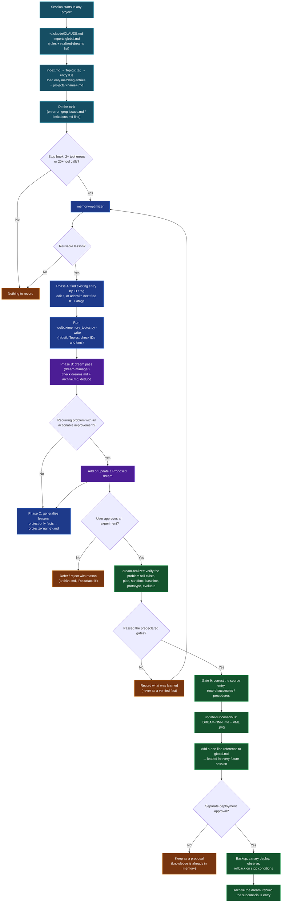

# Memory → dream → subconscious flow

Current as of 2026-11-25. Renders in any Markdown viewer that supports Mermaid. (The old PNG render, with a "Dream Validator" stage that never existed as a skill, was removed; it is in git history.)

