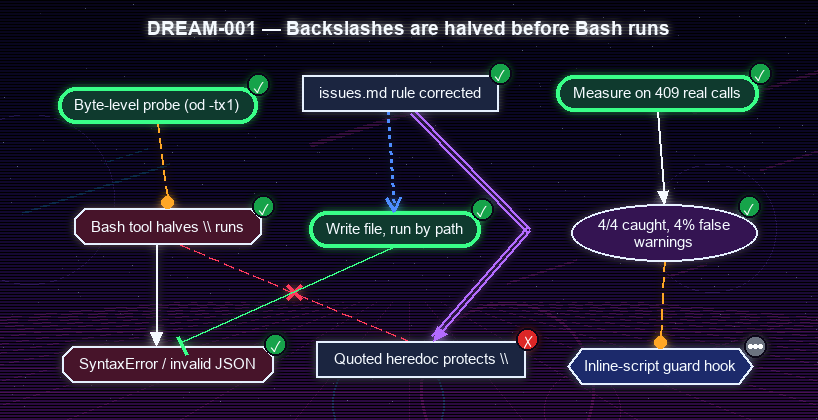

# DREAM-001 — Backslashes are halved before Bash runs

Realized: 2026-11-23 · Outcome: `passed` · Proof: `C:/ai/memories/dreams/experiments/DREAM-001/run-20261123-01/report.md`



## Discovery
The Claude Code Bash tool (verified on 2.1.329, Windows Git Bash) collapses every run of N backslashes to ceil(N/2) before bash sees the command, unless the next character is a double quote. This happens even inside single quotes and quoted heredocs (<<'EOF'), so the long-held advice "use a quoted heredoc" was wrong. It explains SyntaxErrors in inline Python/JS and fixtures that silently became invalid JSON.

## The correct way
1. Write any script, fixture or JSON that contains backslashes, `${`, `$(` or nested quotes with the Write tool, then run or use it by path. Never pass it inline through Bash.
2. To find which layer mangles a command, send a tiny harmless probe (`printf '%s' 'A\\B' | od -An -tx1`) and compare the bytes with the command the transcript recorded. Change one quoting factor at a time.
3. Before building a warning hook or checker, measure it on real past calls: recall on hand-labelled failures and warning rate on calls that worked, compared with the naive trigger.

## Applies when
Any agent session that passes code, JSON or Windows paths through the Bash tool, and any time an inline command fails or writes odd bytes without an error.

## Map
### Nodes
- `P` Byte-level probe (od -tx1) — action, verified, **correct way**. printf '%s' 'A\\B' | od -An -tx1 printed 41 5c 42: one backslash arrived.
- `L` Bash tool halves \\ runs — issue, verified. N backslashes become ceil(N/2) unless followed by a double quote, even in '...' and <<'EOF'.
- `Q` Quoted heredoc protects \\ — fact, rejected. The old advice; refuted by the probe.
- `S` SyntaxError / invalid JSON — issue, verified. Corpus ids 361 (split SyntaxError), 55 and 376 (invalid JSON with exit 0).
- `R` issues.md rule corrected — fact, verified. Entry I-001 (issues.md, Shell & scripting), corrected 2026-11-23.
- `W` Write file, run by path — action, verified, **correct way**. Avoids every shell layer; no backslash or substitution processing.
- `C` Measure on 409 real calls — action, verified, **correct way**. Real transcript corpus, 4 hand-labelled failures, baseline vs naive vs candidate.
- `O` 4/4 caught, 4% false warnings — outcome, verified. Naive trigger warned on 23.1% of good calls; candidate p95 150 ms.
- `H` Inline-script guard hook — tool, pending. Sandbox prototype only; deployment needs separate approval.
### Relations
- Byte-level probe (od -tx1) --evidence_for--> Bash tool halves \\ runs
- Bash tool halves \\ runs --causes--> SyntaxError / invalid JSON
- Bash tool halves \\ runs --contradicts--> Quoted heredoc protects \\
- issues.md rule corrected --supersedes--> Quoted heredoc protects \\
- issues.md rule corrected --requires--> Write file, run by path
- Write file, run by path --fixes--> SyntaxError / invalid JSON
- Measure on 409 real calls --causes--> 4/4 caught, 4% false warnings
- 4/4 caught, 4% false warnings --evidence_for--> Inline-script guard hook

## References
- report: `C:/ai/memories/dreams/experiments/DREAM-001/run-20261123-01/report.md`
- memory: `C:/ai/memories/categories/issues.md`
- successes: `C:/ai/memories/categories/successes.md`
- dream: `C:/ai/memories/dreams/dreams.md#DREAM-001`

## Spec
Generated by `update-subconscious`. Edit this block, then run `rebuild` so the image matches. sha256 `54005fbc9a418b1e`.

```json vml-spec
{
 "id": "DREAM-001",
 "slug": "bash-tool-backslash-layer",
 "title": "Backslashes are halved before Bash runs",
 "date": "2026-11-23",
 "outcome": "passed",
 "discovery": "The Claude Code Bash tool (verified on 2.1.329, Windows Git Bash) collapses every run of N backslashes to ceil(N/2) before bash sees the command, unless the next character is a double quote. This happens even inside single quotes and quoted heredocs (<<'EOF'), so the long-held advice \"use a quoted heredoc\" was wrong. It explains SyntaxErrors in inline Python/JS and fixtures that silently became invalid JSON.",
 "correct_way": [
  "Write any script, fixture or JSON that contains backslashes, `${`, `$(` or nested quotes with the Write tool, then run or use it by path. Never pass it inline through Bash.",
  "To find which layer mangles a command, send a tiny harmless probe (`printf '%s' 'A\\\\B' | od -An -tx1`) and compare the bytes with the command the transcript recorded. Change one quoting factor at a time.",
  "Before building a warning hook or checker, measure it on real past calls: recall on hand-labelled failures and warning rate on calls that worked, compared with the naive trigger."
 ],
 "applies_when": "Any agent session that passes code, JSON or Windows paths through the Bash tool, and any time an inline command fails or writes odd bytes without an error.",
 "nodes": [
  {
   "id": "P",
   "label": "Byte-level probe (od -tx1)",
   "kind": "action",
   "status": "verified",
   "way": true,
   "fact": "printf '%s' 'A\\\\B' | od -An -tx1 printed 41 5c 42: one backslash arrived."
  },
  {
   "id": "L",
   "label": "Bash tool halves \\\\ runs",
   "kind": "issue",
   "status": "verified",
   "fact": "N backslashes become ceil(N/2) unless followed by a double quote, even in '...' and <<'EOF'."
  },
  {
   "id": "Q",
   "label": "Quoted heredoc protects \\\\",
   "kind": "fact",
   "status": "rejected",
   "fact": "The old advice; refuted by the probe."
  },
  {
   "id": "S",
   "label": "SyntaxError / invalid JSON",
   "kind": "issue",
   "status": "verified",
   "fact": "Corpus ids 361 (split SyntaxError), 55 and 376 (invalid JSON with exit 0)."
  },
  {
   "id": "R",
   "label": "issues.md rule corrected",
   "kind": "fact",
   "status": "verified",
   "fact": "Entry I-001 (issues.md, Shell & scripting), corrected 2026-11-23."
  },
  {
   "id": "W",
   "label": "Write file, run by path",
   "kind": "action",
   "status": "verified",
   "way": true,
   "fact": "Avoids every shell layer; no backslash or substitution processing."
  },
  {
   "id": "C",
   "label": "Measure on 409 real calls",
   "kind": "action",
   "status": "verified",
   "way": true,
   "fact": "Real transcript corpus, 4 hand-labelled failures, baseline vs naive vs candidate."
  },
  {
   "id": "O",
   "label": "4/4 caught, 4% false warnings",
   "kind": "outcome",
   "status": "verified",
   "fact": "Naive trigger warned on 23.1% of good calls; candidate p95 150 ms."
  },
  {
   "id": "H",
   "label": "Inline-script guard hook",
   "kind": "tool",
   "status": "pending",
   "fact": "Sandbox prototype only; deployment needs separate approval."
  }
 ],
 "edges": [
  {
   "src": "P",
   "dst": "L",
   "rel": "evidence_for"
  },
  {
   "src": "L",
   "dst": "S",
   "rel": "causes"
  },
  {
   "src": "L",
   "dst": "Q",
   "rel": "contradicts"
  },
  {
   "src": "R",
   "dst": "Q",
   "rel": "supersedes"
  },
  {
   "src": "R",
   "dst": "W",
   "rel": "requires"
  },
  {
   "src": "W",
   "dst": "S",
   "rel": "fixes"
  },
  {
   "src": "C",
   "dst": "O",
   "rel": "causes"
  },
  {
   "src": "O",
   "dst": "H",
   "rel": "evidence_for"
  }
 ],
 "refs": {
  "report": "C:/ai/memories/dreams/experiments/DREAM-001/run-20261123-01/report.md",
  "memory": "C:/ai/memories/categories/issues.md",
  "successes": "C:/ai/memories/categories/successes.md",
  "dream": "C:/ai/memories/dreams/dreams.md#DREAM-001"
 },
 "style": "cyber"
}
```
